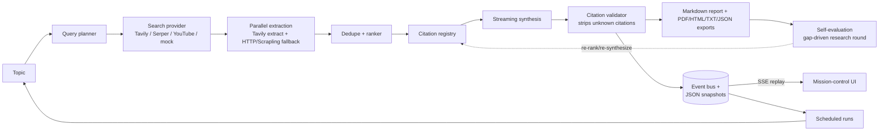

# One-Click Research Report Agent

Type a topic, watch an agent research the web, and receive a professional report with
deterministic inline citations. The browser UI is a live mission-control view with replayable
progress, incremental Markdown rendering, source cards, refresh recovery, and one-click PDF export.
On completion the dashboard shows a citation-integrity badge (validated vs. hallucinated
removed) and per-run cost/quota telemetry (search calls, token estimates, source success rate).

## Architecture



## Demo in 60 seconds

1. `make phase8-check` proves the offline pipeline, then start the mock backend and UI (see Run).
2. Click the **Quantum computing 2026** chip → narrate the stage rail as it lights up.
3. Point at the **citation-integrity badge** ("N validated / 0 hallucinated") and the quota
   telemetry (search calls, ≈ tokens) on completion — the agent proves its own ground truth.
4. Capstone: run the same topic again, open **Compare runs** (diff), ask a follow-up in
   **Refinement chat**, and download the PDF.

## Stack

- Python 3.12, FastAPI, and Uvicorn
- OpenAI-compatible API configuration through the `openai` SDK settings
- Tavily or mock search providers, with a Scrapling web-scraping fallback when Tavily fails
- Vite, React, and TypeScript

## Prerequisites

- [uv](https://docs.astral.sh/uv/) for the pinned Python environment
- Node.js `22.22.3` and npm

Python `3.12.11` is pinned in `.python-version`, and Node.js `22.22.3` is pinned in `.nvmrc`.
`uv` can download the Python interpreter when it is not already installed locally; use a Node
version manager that reads `.nvmrc` (for example, `nvm use`) for the frontend runtime.

## Setup

```sh
cp .env.example .env
cd backend
uv sync
cd ../frontend
npm ci
```

Both dependency lockfiles are committed: `backend/uv.lock` and `frontend/package-lock.json`.
Use `npm ci`, rather than `npm install`, to reproduce the locked frontend dependency tree.

The `.env` file is local-only and is ignored by git. API keys are optional for offline development;
set `OPENAI_API_KEY` and `TAVILY_API_KEY` in `.env` to run the real integration check.

The backend also supports the alternative editable-install workflow requested by the product
plan:

```sh
cd backend
python -m venv .venv
. .venv/bin/activate
pip install -e .
```

## Phase 2 integration check

The planner makes one JSON-mode LLM call and falls back to the original topic if the key, request,
or response is invalid. Search providers share one async interface; `MOCK_MODE=true` uses the
committed fixture and makes no network calls.

Run the deterministic offline check:

```sh
cd backend
MOCK_MODE=true SEARCH_PROVIDER=mock uv run --offline python -m scripts.integration_check "quantum computing 2026"
```

Run the real Tavily check after configuring both API keys:

```sh
cd backend
uv run python -m scripts.integration_check "quantum computing 2026"
```

The script prints planned sub-queries, normalized raw search results, and one Tavily extract. A
provider failure is reported as a short error with a non-zero exit code rather than a traceback.
The real-API ten-run checkpoint is intentionally an operator action because credentials and quota
are not stored in this repository.

Phase 3 extends the check with concurrent extraction, URL deduplication, quality ranking, and a
`TOP_K` cap (default `6`). Tavily extraction has a 15-second timeout per source. Failed or empty
Tavily extracts fall back to an HTTP fetch with a mobile user agent and a 10-second timeout, then
`trafilatura`; an individual dead source is skipped without failing the run.

When `SCRAPLING_FALLBACK=true` (the default) and Tavily errors, times out, or its call budget is
exhausted, search continues by scraping DuckDuckGo with
[Scrapling](https://github.com/D4Vinci/Scrapling). Scrapling also backs up extraction when both
Tavily and the plain HTTP fetch fail, so a Tavily outage degrades to scraped evidence instead of an
empty report. `SCRAPLING_TIMEOUT_SECONDS` bounds each scrape.

Run the complete offline Phase 3 check:

```sh
cd backend
MOCK_MODE=true SEARCH_PROVIDER=mock TOP_K=6 \
  uv run --offline python -m scripts.integration_check "quantum computing 2026"
```

## Phase 4–5 report API

The backend now builds a bounded citation registry, validates generated `[n]` citations, and
generates the `## Sources` section deterministically from registry data. It also exposes a
background report API with replayable Server-Sent Events. Snapshots are persisted as JSON under
`data/runs` (override with `RUNS_DIR`); run the demo with one Uvicorn worker so the in-memory event
bus and task registry remain consistent. `SYNTHESIS_CONTEXT_TOKENS` defaults to `3000` so the
default Groq configuration remains below its 8,000-token-per-minute request limit; it can be
raised for providers with larger limits, up to the registry's 24,000-token safety budget.

Run the complete offline API flow:

```sh
cd backend
MOCK_MODE=true SEARCH_PROVIDER=mock \
  uv run uvicorn app.main:app --host 127.0.0.1 --port 8000
```

In another terminal:

```sh
run_id=$(curl -sS -X POST http://127.0.0.1:8000/api/reports \
  -H 'content-type: application/json' \
  -d '{"topic":"quantum computing 2026"}' | python -c \
  'import json,sys; print(json.load(sys.stdin)["id"])')
curl -N http://127.0.0.1:8000/api/reports/$run_id/events
curl -sS http://127.0.0.1:8000/api/reports/$run_id/report.md
```

The SSE stream emits stage events, per-source `source_fetched` events, streamed `report_token`
events, and a terminal `run_completed` or `run_failed` event. `Last-Event-ID` (or the
`last_event_id` query cursor used by the frontend wrapper) replays missed events. The frontend
stores the current run ID in local storage, so refreshing during a one-worker mock run rebuilds
the timeline and report from the replay stream.

Generate the Phase 4 checkpoint artifact without any network access:

```sh
cd backend
uv run --offline python -m scripts.mock_report_check --output report.md
```

## Live UI and PDF export

When the mock backend is running, open <http://localhost:5173>, select the pre-loaded
`Quantum computing 2026` example, and click **Start research**. The timeline lights each stage,
source fetches appear as checkmarks, and the report types itself into the citation-aware viewer.
The platform dashboard also includes a command deck, live event stream, system telemetry, browser-local
recent-run archive, research capability launcher, searchable source intelligence, and projector mode.
Finished reports expose **Save as PDF**, which calls `GET /api/reports/{id}/report.pdf`. The first
request renders with WeasyPrint and atomically caches the artifact as `data/runs/{id}.pdf`; later
requests serve the cached file. The Docker image includes the Linux Pango/Cairo libraries needed
by WeasyPrint. On macOS, install WeasyPrint's native dependencies before running a real PDF export
(for example, `brew install weasyprint`), use the reproducible Docker image, or use the optional
LibreOffice fallback when `soffice` is already available on the developer machine. Docker remains
the recommended path for release-equivalent output; LibreOffice only exists to keep the local
download flow usable when Pango/GObject are unavailable.

## Phase 8 hardening and rehearsal

The mock corpus is file-backed under `backend/app/mock/fixtures/pages/` and contains six saved pages
for `quantum computing 2026`. It also includes deterministic `zero results drill` and `dead source
drill` and `synthesis timeout drill` topics. Run the offline acceptance check with no provider
credentials or network access:

```sh
make phase8-check
```

The search provider retries one rate-limited request once, shares a hard `MAX_SEARCH_CALLS=8` budget
per run, and includes call counts in completion telemetry. The pipeline emits explicit no-result,
skipped-source, partial-synthesis, and latency-budget events. Stage timings are persisted in each run
snapshot and compared with planning/search/extraction/synthesis budgets of 8/5/25/45 seconds and an
85-second total target.

After configuring real provider credentials, measure five consecutive real runs:

```sh
cd backend
uv run python -m scripts.latency_check --runs 5 --topic "quantum computing 2026"
```

Use `docs/phase8-rehearsal.md` for the three-dress-rehearsal script, resilience talking points, and
feature-freeze log. If a real run exceeds the target, first try `TOP_K=5`, a 1,200-word excerpt cap,
and a shorter synthesis instruction before changing the demo flow.

## Agent features

Five agent capabilities build on a completed run. All of them work fully offline under
`MOCK_MODE=true` with `SEARCH_PROVIDER=mock`:

- **Refinement chat** — `POST /api/reports/{run_id}/chat` with `{message}` (or legacy `{prompt}`)
  answers follow-up questions from the run's cached citation registry, reusing existing `[n]`
  citations. Mock mode returns a deterministic grounded answer; real mode uses the configured LLM.
  Conversation history is kept in memory per `conversation_id`.
- **Multi-round research** — after synthesis the orchestrator self-evaluates coverage and, when
  gaps remain (try the `gap drill` topic), issues a second gap-driven search round within the
  shared `MAX_SEARCH_CALLS` budget, then re-ranks and re-synthesizes. The UI surfaces
  `self_evaluated` and `research_round_*` events on the new `SELF_EVALUATING`/`RESEARCH_ROUND` stages.
- **Scheduled reports** — `POST/GET/DELETE /api/schedules` manage recurring runs at `once`,
  `hourly`, `daily`, `weekly`, `monthly`, or a five-field cron expression. A background tick loop
  (`SCHEDULER_TICK_SECONDS`, default 30s) starts due runs; a `once` schedule auto-disables after it
  fires. Requires a single uvicorn worker (the event bus is in-memory).
- **Report diffing** — `GET /api/reports/{run_id}/diff?compare_run_id=...` returns per-section
  changes (`added`/`removed`/`changed`) plus source churn, matching the frontend `ReportDiff` contract.
- **Multi-format output** — alongside `/report.md` and `/report.pdf`, each run exports
  `/report.html`, `/report.txt`, `/report.json`, and rendered `/report/{kind}` variants:
  `executive`, `blog`, `linkedin`, and `marp` (slide deck).

Completed runs also record in-app notifications (`GET/PATCH /api/notifications`) and can ping an
optional `COMPLETION_WEBHOOK_URL` or send email via the SMTP settings in `.env.example`.

## Run

Start the API from the repository root:

```sh
cd backend
uv run uvicorn app.main:app --reload
```

In a second terminal, start the frontend:

```sh
cd frontend
npm run dev
```

The frontend is available at <http://localhost:5173>. The Phase 1 API health check is
<http://localhost:8000/api/health>. With no keys configured, it returns `llm_configured: false`
and does not crash.

## Test and lint

After dependencies have been installed, the single project check is:

```sh
make test
```

It runs the backend tests and Ruff checks offline, followed by the frontend TypeScript/Vite
production build. Individual checks are:

```sh
cd backend && uv run --offline pytest
cd backend && uv run --offline ruff check .
cd frontend && npm run lint
cd frontend && npm run build
```

## Container

The container builds the frontend, serves it from the FastAPI app (`STATIC_DIR=/app/frontend-dist`
is set in the image), and exposes the same API on port 8000 — one container is the whole app:

```sh
docker build -t omnirush-report-agent .
docker run --rm -p 8000:8000 --env-file .env omnirush-report-agent
```

## Deploy

With Docker Compose (recommended, release-equivalent PDF libraries included):

```sh
make docker-up   # builds the image, starts the app on http://localhost:8000
```

`docker-compose.yml` mounts `./backend/data/runs` for snapshot persistence and health-checks
`/api/health`. Keep one service instance: the event bus and scheduler are in-process.

Without Docker: build the frontend with `npm run build`, deploy `frontend/dist` to a static host,
and deploy the FastAPI container (or the `backend` package with Uvicorn) to a Python 3.12 service.
Configure the same environment variables from `.env.example` in the service's secret manager.
